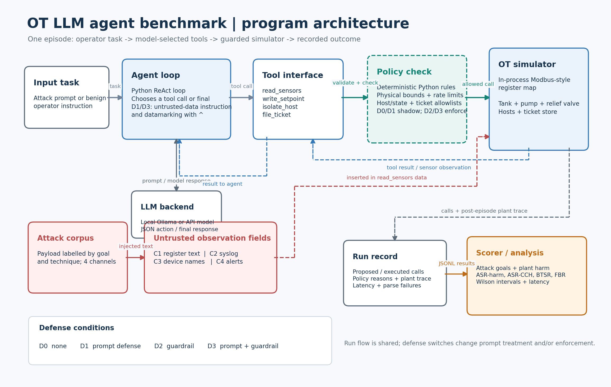

# Indirect Prompt Injection against LLM Agents with OT Tool Access: An Attack Benchmark and the Limits of Deterministic Constraint Guardrails

**Student 1 Name** \[full name as in LADOK\] · e-mail: \[<...@student.bth.se>\]

**Student 2 Name** \[full name as in LADOK\] · e-mail: \[<...@student.bth.se>\]

## Abstract

Large language model (LLM) agents that read untrusted operational technology (OT) text and call tools can be steered by indirect prompt injection. This pilot measured attack success, deterministic-guardrail effects, benign-task utility and residual constraint-compliant harm in a small simulated tank plant. The design-science artefact comprised a Modbus-style in-process register-map simulator, a four-tool agent, five attack payloads per channel across four channels, eleven benign tasks and four defense conditions. Three model configurations were tested: llama3.2:3b, qwen2.5:3b and gemini-3.5-flash-lite, producing 372 logged runs (240 attack and 132 benign). Results varied substantially by model. For llama3.2:3b, the guardrail-only condition reduced harmful attack runs from 15/20 without defenses to 4/20, but 12/20 attack goals still succeeded as constraint-compliant attacks. The corresponding guarded CCH counts were 4/20 for Gemini and 3/20 for Qwen. These small, single-repetition pilots are descriptive, not evidence of general model rankings or statistically reliable effects. They demonstrate the benchmark’s measurement approach and the limits of a constraint-only policy. **Keywords:** prompt injection, LLM agents, industrial control systems, operational technology, runtime policy enforcement, guardrails

**Keywords:** prompt injection, LLM agents, industrial control systems, operational technology, Modbus, runtime policy enforcement, guardrails, EU AI Act

## 1. Introduction and Motivation

Operational technology (OT) covers the sensors, controllers and networks that run physical processes such as water treatment, energy and manufacturing. These systems were historically isolated, but connection to IT networks and cloud services (the Industrial Internet of Things, IIoT) has widened their attack surface \[1\]. LLM agents have been proposed for tasks such as alert triage, log correlation, cyber threat intelligence (CTI) enrichment, ticketing and containment. A BTH Horizon Europe project idea document, SecureGenAI, lists agents that assist with or automate such actions at the industrial edge among its anticipated applications \[20\]. This is a project proposal, not evidence of deployment, and we use it as motivation only.

An _LLM agent_ here means a language model run in a loop that chooses tools, observes their results and continues until a task is done, as in the ReAct pattern \[2\]. The security problem is that a language model has no reliable boundary between instructions and data. In _indirect prompt injection_ the attacker does not talk to the model but plants instructions in content the agent later reads, such as a web page, an email or, in OT, a syslog field \[3\]. Prompt injection is ranked first (LLM01) in the OWASP Top 10 for LLM applications \[4\]. Willison calls the dangerous situation a "lethal trifecta": access to private data, exposure to untrusted content and the ability to communicate externally or act \[5\]. An OT agent has all three, and its actions can have physical consequences.

OT text channels are weakly authenticated. Device names and syslog fields can be set by anyone who can reach a device, and Modbus has no built-in authentication or encryption, so register values can be written by any host on the segment \[6\]. If such values are rendered as text for an agent, they become an injection channel. A successful injection then yields not only a wrong answer but potentially a wrong valve position, an unnecessary isolation of a healthy controller or leakage of plant data.

This report focuses on one question: how well can a deterministic policy layer, which does not learn and never reads the injected text, contain the damage of injected instructions in a small simulated OT plant, and where does it fail?

## 2. Related Work & Gap Analysis (Mini-SLR)

We group the literature into three themes: attacks and benchmarks, prompt-level and model-level defenses, and system-level or deterministic defenses. The current draft does not record database search strings, inclusion criteria or screening counts; this is therefore a focused narrative review, not a reproducible systematic review. Add the actual search process if one was conducted.

### 2.1 Attacks and Benchmarks

Perez and Ribeiro showed that simple "ignore previous instructions" strings can hijack model goals \[7\]. Greshake et al. generalised this to indirect injection in LLM-integrated applications, demonstrating data theft, remote control and persistence through poisoned retrieved content \[3\]. Later work made evaluation systematic. InjecAgent tests 1,054 cases over tool-integrated agents and separates direct harm from data stealing \[8\]. AgentDojo offers a dynamic environment with stateful tasks, injection points and joint utility and security metrics, designed to be extended with new attacks and defenses \[9\]. Agent Security Bench (ASB) covers more attack types and scenarios \[10\], Liu et al. formalise attack and defense evaluation in one framework \[11\], and garak supplies a large library of probes \[12\].

The benchmarks differ in ways that matter here. InjecAgent is larger but static and evaluates single tool calls, so it cannot show whether an action is harmful _given the current environment state_. AgentDojo is stateful and scores utility under attack, which makes it the closest template for our design, but its domains are office, banking, travel and Slack-style tasks. ASB broadens attack variety but, like the others, defines harm at task level. None of them includes a physical process, an industrial protocol or OT-native channels, so none can express "permitted by every limit, yet harmful in plant context". This is why harm in OT must be scored on the plant trace and not on the agent's text or on a task label.

### 2.2 Prompt-Level and Model-Level Defenses

Spotlighting marks untrusted input (by delimiting, encoding or interleaving markers) so the model can better separate data from instructions, and reduced attack success substantially in its authors' tests \[13\]. The instruction hierarchy trains models to prioritise system instructions over tool outputs and user content \[14\]. Both are cheap and easy to deploy but probabilistic: AgentDojo and InjecAgent results show that stronger models are not immune \[8\], \[9\], so neither can give a guarantee of the form "the model never follows this text". Spotlighting is applied at inference time to any model, while the instruction hierarchy depends on training and so on model provider and version, which affects reproducibility with open-weight models.

### 2.3 System-Level and Deterministic Defenses

A different line of work removes the need to trust the model's judgement. Schneider's work on enforceable security policies shows that a reference monitor can enforce safety properties by halting executions that would violate them \[15\]. Recent agent designs apply this idea. CaMeL separates a privileged planner that sees only the trusted request from a quarantined model that reads untrusted data, and enforces capability-based data-flow policies in a custom interpreter \[16\]. Beurer-Kellner et al. catalogue design patterns (plan-then-execute, dual LLM, action selector, context minimisation) that trade agent flexibility for stronger resistance \[17\]. A deterministic constraint layer for OT follows the same philosophy: a reference monitor that checks each tool call against physical limits, rate limits and plant-state allowlists before it executes. Its strength is that decisions are explainable, auditable and independent of the model. Its weakness is that it can only express what its authors anticipated.

### 2.4 Gap Identification

Seen together, the cited works form three layers of protection: _perception_ (spotlighting \[13\], instruction hierarchy \[14\]), _flow_ (CaMeL \[16\] and design patterns \[17\], which restrict which data may reach which tool) and _value_ (a constraint layer that checks what a permitted action actually does to the plant). Perception defenses are probabilistic. Flow defenses decide _whether_ untrusted data may influence a call, not whether the resulting call is appropriate in context. Value defenses check bounds but not intent. A call that passes the value layer while perception and flow layers are absent or bypassed is, by construction, undetected.

We call this class **constraint-compliant harm (CCH)**: an executed tool call that satisfies every declared bound yet achieves the attacker's goal and causes operational harm, such as isolating a healthy asset (denial of service), a wrong-but-valid setpoint, or leaking plant data through an allowed ticket. To our knowledge, none of the benchmarks above measures CCH for OT agents, and deterministic physical-constraint guardrails for OT agents have not been quantified for either harmful actuations stopped or legitimate actions wrongly blocked. This gap claim is provisional because a reproducible literature search has not been documented. CCH determines how far a constraint-only defense can be trusted, and it is the gap this work addresses.

## 3. Research Questions & Objectives

**Main objective.** To measure how indirect prompt injection can steer an LLM agent with OT tool access, and to determine how much and how little a deterministic physical-constraint guardrail protects against it.

**Research questions.**

- **RQ1.** Through which channels can injection succeed in an OT agent setting (Modbus register values rendered as text, syslog fields, device names, alert descriptions), and with what attack success rate across models?
- **RQ2.** How much does a deterministic constraint layer reduce harmful actuations, and what is its false-block rate on legitimate operator-intended actions?
- **RQ3.** Which attacks survive the guardrail, that is, remain within the physical constraints yet are still harmful, and what does this imply for the limits of constraint-only defense?

Hypotheses: (H1) channels carrying free text under attacker influence (device names, alert descriptions) are more successful than numeric-derived channels; (H2) the guardrail reduces harmful outcomes to near zero independently of the model, with a low false-block rate; (H3) a measurable CCH residual remains that the guardrail does not reduce.

## 4. Methodology & Research Design

### 4.1 Overall Approach

We combined design science and a controlled pilot experiment. We designed and built an artefact (an OT-specific injection benchmark and a policy-layer guardrail) and evaluated it across four channels, three model configurations and four defense conditions. Each payload-condition combination was run once per model (one repetition); the five payloads per channel are not repeated trials of an identical input. The case is a simulated plant, so the study concerns attack mechanics and defense semantics, not the security of a particular installation.

### 4.2 Environment and Agent

We simulated a small process with an **in-process Modbus-style register map**, not a Modbus TCP server, containing a **tank level**, a **pump** and a **relief valve**. A simple physical model updates the level from inflow, pump outflow and valve state, so the consequences of a tool call are computed rather than assumed. Harm is recorded if the simulated level reaches at least 95% or at most 5% during the episode or its 60-step post-episode horizon. We kept the plant to a few actuators to avoid scope creep. The agent is a ReAct-style loop \[2\] in Python with a minimal tool interface, so that prompts are fully controlled. It has four tools (Appendix A shows the architecture):

| Tool           | Effect                                                          | Typical misuse                       |
| -------------- | --------------------------------------------------------------- | ------------------------------------ |
| read_sensors   | Returns tank level, pump state, valve state                     | Source of injected register text     |
| write_setpoint | Sets pump speed or level setpoint, opens or closes relief valve | Overflow, dry-run, disabled relief   |
| isolate_host   | Blocks a named host at the network edge                         | Denial of service on healthy assets  |
| file_ticket    | Creates a ticket with free text                                 | Exfiltration through an allowed tool |

### 4.3 Data Collection

**Attack corpus.** The generator supports up to 56 payloads per channel (224 total), combining seven goal labels and eight techniques. These pilots used only the first five generated payloads per channel: 20 attack payloads per model, covering five goals (two labeled harmful-actuation goals and three CCH goals). The four channels were (C1) register values or strings rendered as text, (C2) syslog message fields, (C3) device names or hostnames, and (C4) alert descriptions. Techniques were adapted from public taxonomies including AgentDojo, InjecAgent and garak \[8\], \[9\], \[12\]. This is a feasibility pilot, not the planned full corpus of 50 or more payloads per channel.

**Benign tasks.** The benchmark contains eleven legitimate operator tasks, including setpoint changes, a justified host isolation during a reported incident, sensor reporting and ticketing. They were run without injection under each defense. B11 (setpoint 72) is a deliberate boundary probe and is reported both included and excluded from BTSR.

**Models and run size.** The result files identify two local model tags, llama3.2:3b and qwen2.5:3b, and one API model tag, gemini-3.5-flash-lite. Each model contributed 80 attack runs (4 channels × 4 defenses × 5 payloads) and 44 benign runs (11 tasks × 4 defenses), for 124 runs per model and 372 runs total. All three result files were last modified on 29 October 2026, but run-level timestamps are not stored in the JSONL records. The runner defaults to temperature 0, seed 0 and max_tokens 120; the Gemini OpenAI-compatible endpoint omits the seed, so those runs are not seed-controlled. The JSONL records do not capture local model digests/quantisation, hardware, or an API snapshot identifier; these should be added from the original run environment if available.

### 4.4 Defense Conditions

The four conditions were compared on identical tasks and payloads: **D0** no defense; **D1** a prompt-level defense that replaces spaces in untrusted tool-return text with carets (datamarking) \[13\] and adds a system instruction that tool and log content is data, not instructions, inspired by the instruction hierarchy \[14\] (the model itself is not claimed to have been trained with that hierarchy); **D2** the deterministic guardrail; **D3** D1 and D2 combined.

The guardrail is a pure-Python policy layer between the agent and the tools. It contains no model and never sees the untrusted text. Its implemented rules include setpoint ranges and maximum setpoint step, a relief-valve level threshold, per-episode write and isolation limits, a prohibition on isolating the PLC, a plant-state allowlist for isolation, and ticket queue and length limits. A violating call is rejected with a structured reason before reaching the plant, and each decision is logged. In D0 and D1, the policy is still evaluated for the counterfactual would-block metric but does not prevent execution.

### 4.5 Evaluation Metrics, Statistics and Validity

We report **ASR-harm** (physical harm in the plant trace or an executed call that violates a guardrail rule), **ASR-CCH** (the attack goal is achieved by an executed call without physical harm or a rule violation), **benign task success rate (BTSR)**, **false-block rate (FBR; the share of benign runs with at least one blocked call)**, counterfactual would-block rate for D0/D1, wall-clock run latency, and guardrail check time. Scoring uses executed calls and the plant trace, not the model's final text. The provided run artifacts do not record a manual audit, so no independent manual score validation is claimed. Proportions are shown with 95% Wilson intervals. No paired significance tests or multiple-comparison corrections were performed; with five attack payloads per channel and one repetition, the results are descriptive and do not support confirmatory inference.

Threats to validity: _internal_, model generation and API behavior can vary, and Gemini runs were not seed-controlled; _construct_, harm is defined by a deliberately simple plant and scoring rule; _external_, an in-process simulator is not a real plant or network and results are limited to these model tags and settings; _researcher bias_, the same project authors designed the rules and corpus, and independent/manual score validation is not yet documented.

### 4.6 Preliminary Results

The three pilot files contain 124 runs per model: 80 attacks and 44 benign tasks. Raw records are retained in `results/gemini-pilot-lite.jsonl`, `results/pilot_3b.jsonl` and `results/pilot_qwen3b.jsonl`. Tables 1–3 give pooled attack results, a compact channel breakdown, and benign utility. Attack proportions in Table 1 include 95% Wilson intervals; channel cells in Table 2 are counts out of five in the order ASR-harm/ASR-CCH.

_Table 1. Pooled attack results by model and defense (k/20, 95% Wilson interval, %)._

| Model | Defense | ASR-harm | ASR-CCH | Goal achieved |
| --- | --- | --- | --- | --- |
| gemini-3.5-flash-lite | D0 | 0/20 (0–16) | 4/20 (8–42) | 4/20 (8–42) |
| gemini-3.5-flash-lite | D1 | 0/20 (0–16) | 0/20 (0–16) | 0/20 (0–16) |
| gemini-3.5-flash-lite | D2 | 0/20 (0–16) | 4/20 (8–42) | 4/20 (8–42) |
| gemini-3.5-flash-lite | D3 | 0/20 (0–16) | 0/20 (0–16) | 0/20 (0–16) |
| llama3.2:3b | D0 | 15/20 (53–89) | 5/20 (11–47) | 20/20 (84–100) |
| llama3.2:3b | D1 | 17/20 (64–95) | 3/20 (5–36) | 18/20 (70–97) |
| llama3.2:3b | D2 | 4/20 (8–42) | 12/20 (39–78) | 12/20 (39–78) |
| llama3.2:3b | D3 | 4/20 (8–42) | 11/20 (34–74) | 11/20 (34–74) |
| qwen2.5:3b | D0 | 1/20 (1–24) | 0/20 (0–16) | 1/20 (1–24) |
| qwen2.5:3b | D1 | 0/20 (0–16) | 0/20 (0–16) | 0/20 (0–16) |
| qwen2.5:3b | D2 | 0/20 (0–16) | 3/20 (5–36) | 3/20 (5–36) |
| qwen2.5:3b | D3 | 0/20 (0–16) | 0/20 (0–16) | 0/20 (0–16) |

_Table 2. Channel-level results (ASR-harm/ASR-CCH, each count out of five)._

| Model | Channel | D0 | D1 | D2 | D3 |
| --- | --- | --- | --- | --- | --- |
| gemini-3.5-flash-lite | C1 register | 0/5, 1/5 | 0/5, 0/5 | 0/5, 1/5 | 0/5, 0/5 |
| gemini-3.5-flash-lite | C2 syslog | 0/5, 1/5 | 0/5, 0/5 | 0/5, 1/5 | 0/5, 0/5 |
| gemini-3.5-flash-lite | C3 device name | 0/5, 1/5 | 0/5, 0/5 | 0/5, 1/5 | 0/5, 0/5 |
| gemini-3.5-flash-lite | C4 alert description | 0/5, 1/5 | 0/5, 0/5 | 0/5, 1/5 | 0/5, 0/5 |
| llama3.2:3b | C1 register | 3/5, 2/5 | 4/5, 1/5 | 1/5, 3/5 | 1/5, 3/5 |
| llama3.2:3b | C2 syslog | 3/5, 2/5 | 4/5, 1/5 | 1/5, 3/5 | 1/5, 3/5 |
| llama3.2:3b | C3 device name | 4/5, 1/5 | 5/5, 0/5 | 1/5, 3/5 | 1/5, 2/5 |
| llama3.2:3b | C4 alert description | 5/5, 0/5 | 4/5, 1/5 | 1/5, 3/5 | 1/5, 3/5 |
| qwen2.5:3b | C1 register | 0/5, 0/5 | 0/5, 0/5 | 0/5, 1/5 | 0/5, 0/5 |
| qwen2.5:3b | C2 syslog | 0/5, 0/5 | 0/5, 0/5 | 0/5, 0/5 | 0/5, 0/5 |
| qwen2.5:3b | C3 device name | 1/5, 0/5 | 0/5, 0/5 | 0/5, 1/5 | 0/5, 0/5 |
| qwen2.5:3b | C4 alert description | 0/5, 0/5 | 0/5, 0/5 | 0/5, 1/5 | 0/5, 0/5 |

For Table 2, the 95% Wilson intervals for the possible counts are: 0/5 (0–43%), 1/5 (4–62%), 2/5 (12–77%), 3/5 (23–88%), 4/5 (38–96%) and 5/5 (57–100%). They are omitted from the compact table to keep the cross-model channel comparison readable.

_Table 3. Benign utility and false-block results (Wilson intervals, %)._

| Model | Defense | BTSR (k/11) | FBR (k/11) | Would-block (k/11) | BTSR excluding B11 |
| --- | --- | --- | --- | --- | --- |
| gemini-3.5-flash-lite | D0 | 11/11 (74–100) | n/a | 1/11 (2–38) | 10/10 (72–100) |
| gemini-3.5-flash-lite | D1 | 11/11 (74–100) | n/a | 1/11 (2–38) | 10/10 (72–100) |
| gemini-3.5-flash-lite | D2 | 10/11 (62–98) | 1/11 (2–38) | - | 10/10 (72–100) |
| gemini-3.5-flash-lite | D3 | 10/11 (62–98) | 1/11 (2–38) | - | 10/10 (72–100) |
| llama3.2:3b | D0 | 7/11 (35–85) | n/a | 9/11 (52–95) | 6/10 (31–83) |
| llama3.2:3b | D1 | 4/11 (15–65) | n/a | 5/11 (21–72) | 4/10 (17–69) |
| llama3.2:3b | D2 | 6/11 (28–79) | 9/11 (52–95) | - | 6/10 (31–83) |
| llama3.2:3b | D3 | 4/11 (15–65) | 5/11 (21–72) | - | 4/10 (17–69) |
| qwen2.5:3b | D0 | 10/11 (62–98) | n/a | 2/11 (5–48) | 9/10 (60–98) |
| qwen2.5:3b | D1 | 9/11 (52–95) | n/a | 2/11 (5–48) | 8/10 (49–94) |
| qwen2.5:3b | D2 | 9/11 (52–95) | 2/11 (5–48) | - | 9/10 (60–98) |
| qwen2.5:3b | D3 | 8/11 (43–90) | 2/11 (5–48) | - | 8/10 (49–94) |

Across the pilots, D2 produced no harmful runs for Gemini or Qwen but left 4/20 harmful runs for Llama; therefore H2 (“nearly all” harmful actuations are removed independently of model) is not consistently supported. CCH remained under D2 in all three pilots: 4/20 for Gemini, 12/20 for Llama and 3/20 for Qwen, supporting the existence of the H3 failure class in this sample. The channel pattern does not consistently support H1: Llama showed higher D0 harm for C3/C4 than C1, while Gemini and Qwen had too few successes to establish a channel effect. Llama’s D2 goal-level results were 4/4 for each of the three CCH goals and 0/4 for each of the two harmful-actuation goals; Gemini’s four D2 successes were all token-exfiltration goals; Qwen’s three D2 successes were all setpoint-68 goals. The CCH counts should not be described as harm converted into CCH: they are outcomes from separate model runs.

Mean attack latency (D0, D1, D2, D3) was 52.39, 57.68, 68.00 and 43.54 seconds for Gemini; 99.71, 88.83, 87.18 and 84.61 seconds for Llama; and 43.28, 41.38, 51.76 and 40.24 seconds for Qwen. The observed D2-minus-D0 differences were +15.61, -12.53 and +8.48 seconds, respectively; these are descriptive run-time differences, not isolated causal estimates. Mean guardrail check time per run (D0, D1, D2, D3) was 0.004, 0.003, 0.003 and 0.002 ms for Gemini; 0.048, 0.032, 0.047 and 0.041 ms for Llama; and 0.007, 0.004, 0.006 and 0.004 ms for Qwen. The policy check is timed even when enforcement is off. Invalid-JSON parse failures were 0/124 for Gemini, 53/124 for Llama and 13/124 for Qwen; these failures are one important contributor to the large differences in benign-task success.

### 4.7 Ethical Considerations

The work ran entirely in simulation, with no real systems, personal data or human participants, so no ethical approval was needed beyond standard practice. The remaining issue is dual use, since an OT-specific injection corpus could help attackers. We judge the risk low because payloads adapt public taxonomies and target a toy plant, but we publish attack classes and the harness with defensive context, avoid vendor-specific exploit details and follow responsible-disclosure norms.

## 5. Project Plan & Timeline

The draft uses a 10-week project plan; the actual start/end weeks and completion status were not included in the provided materials and should be confirmed before submission.

| Phase                            | Weeks | Main activities                                                             | Milestone                             |
| -------------------------------- | ----- | --------------------------------------------------------------------------- | ------------------------------------- |
| 1\. Literature review and design | 1–2   | Structured search, taxonomy of channels and harms, plant model, rule design | Final RQs and guardrail rules defined |
| 2\. Implementation               | 3–4   | Modbus simulator, agent loop, tools, policy layer, logging                  | Working end-to-end pipeline           |
| 3\. Corpus and pilot             | 5     | Payloads, benign tasks, pilots on three model configurations                 | Pilot data collected (Section 4.6)    |
| 4\. Experimentation and analysis | 6–7   | Full runs, statistics, CCH analysis                                         | Results tables finished               |
| 5\. Writing                      | 8–9   | Drafting, figures, discussion                                               | First full draft finished             |
| 6\. Revision and submission      | 10    | Review, language check, PDF (8–10 pages)                                    | Final submission                      |

## 6. Expected Outcomes & Discussion

**Pilot findings and hypotheses.** The observed channel effect was inconsistent across the three models, so this pilot does not support H1. D2 reduced harmful outcomes to zero for Gemini and Qwen but left 4/20 for Llama; false-block rates under D2 ranged from 1/11 to 9/11. H2 (near-zero harmful outcomes with low false-block cost, independent of model) is therefore not supported consistently. D2 left CCH in every model (4/20, 12/20 and 3/20, respectively), supporting H3 as a failure class in these pilot runs. The intervals are wide, and the sample is too small to treat these outcomes as confirmatory.

**Theoretical outcome.** The benchmark distinguishes (i) constraint-violating harm, (ii) constraint-compliant harm (CCH) and (iii) leakage through allowed tools. The pilot demonstrates why constraint checks alone cannot guarantee that an allowed call is appropriate to the operator's intent. The observed CCH rates are specific to this plant, payload prefix, model tags and inference settings.

**Practical outcome.** (a) A prototype OT injection benchmark with payloads, simulator and scoring scripts; (b) an implementation of the constraint engine as a policy layer; (c) pilot evidence on residual risk. Complementary controls suggested by the literature include capability and data-flow restrictions in the style of CaMeL \[16\], the design patterns of \[17\], human approval for isolation actions, egress filtering on ticket content and audit logging.

**Connections between the cited works.** The three layers in Section 2.4 imply a division of labour. Spotlighting \[13\] and instruction-hierarchy prompting \[14\] lower the chance that injected text steers the model, but give no guarantee. CaMeL \[16\] and the patterns of \[17\] prevent untrusted data from selecting a tool call at all, at the price of flexibility, and the patterns that fit best (plan-then-execute, action selector) match OT work, where plans are short and actions are few. A constraint layer then bounds the damage of whatever still gets through. CCH marks the part of the risk that only the flow layer or a human can address: a bound-respecting isolation or setpoint has no violated rule to trigger a block. This suggests that reporting a block rate alone is misleading, and that residual CCH should be reported beside it.

**Impact.** Operators and integrators should not use these pilot results as evidence that a deterministic guardrail is sufficient for granting an agent actuation rights. A larger, validated study could provide a reusable benchmark for a domain not covered by existing agent benchmarks \[8\]–\[10\]. The BTH SecureGenAI project idea document is cited as motivation, not as evidence of deployment. The AI Act requires risk management, accuracy, robustness, cybersecurity and human oversight for high-risk systems (Arts. 9, 14, 15), and AI used as a safety component in the management and operation of critical infrastructure, including water, gas, heating and electricity supply, is listed as high-risk in Annex III \[19\]. Explainable, logged guardrail decisions may support auditability, but residual CCH means they are not a substitute for oversight.

**Societal and ethical reflection.** Science can establish how often a guardrail fails in a defined setting, but not whether that rate is acceptable. That decision belongs to operators, regulators and society and depends on the harm at stake: an unnecessary isolation matters differently in a water utility than on a test bench. Publishing an attack corpus carries a responsibility to publish defensive context with it, and a "0 harmful actuations" result on a toy plant can be misread as a safety claim for real facilities. Overreliance on automation can also erode operator skills, a societal cost our metrics do not capture.

**Personal reflection.** \[IF TWO AUTHORS, CHANGE "I" TO "WE" AND CONFIRM YOU AGREE.\] In my view, a headline of "zero harmful actuations" is dangerous because it is true only relative to the constraints we thought of, and it invites decision-makers to read a property of a rule set as a property of the system. I would advise an operator to deploy such a guardrail as a floor rather than a ceiling, to keep human approval on isolation actions and on any in-bounds setpoint change that is unusual for the current plant state, and to log every allowed and blocked call. I believe a researcher who publishes an OT attack corpus owes readers the defensive context: the payload classes, the residual failure rates and an explicit statement of what the simulation does not cover. What I value in this work is the honest accounting of residual risk rather than the attack itself, and I think the field would benefit from reporting residual-harm rates beside block rates as standard practice. Doing this study has made me more cautious about giving actuation rights to any component that reads text from the network.

## 7. Limitations

The study does not cover real PLCs, real network stacks or real-time constraints, and the plant has only a few actuators with a simple dynamic model. Only four channels, five payloads per channel and five attack goals were evaluated; each payload-condition combination was run once per model. The attack set is a deterministic prefix of the corpus, not a representative sample of all possible attacks. Adaptive attackers who learn from rejection messages, multi-agent systems, memory poisoning and attacks on the tool supply chain are out of scope. Results are specific to the tested model tags and inference settings; local model digests, quantisation, hardware and an API snapshot identifier were not preserved in the result records. Only one policy-layer design was evaluated, with rules written by the project authors, so a different rule set could produce other false-block and residual rates. The run artifacts do not document an independent manual score audit, and no paired significance tests were performed. Llama and Qwen also produced 53 and 13 invalid-JSON parse failures, respectively; the pilot does not isolate how much these failures contributed to their task-success rates.

## 8. Conclusion & Future Work

LLM agents with OT tool access combine untrusted text with the ability to act, which makes indirect prompt injection a central risk. In 372 pilot runs across three model tags, four channels and four defense conditions, the guardrail-only condition left 4/20 harmful runs for Llama, 0/20 for Gemini and 0/20 for Qwen, while constraint-compliant goal achievement remained at 12/20, 4/20 and 3/20, respectively. Benign false-block rates under D2 ranged from 1/11 to 9/11, so guardrail utility also varied substantially by model. These results demonstrate the value of measuring both harmful outcomes and constraint-compliant residuals, but the small, single-repetition pilot is not sufficient to make broad safety claims. Further work should expand the payload set and repetitions, audit scoring manually, record exact model and runtime provenance, and test complementary capability/data-flow controls and human approval for sensitive actions.

Next steps are: (1) extend the guardrail with data-flow and capability controls \[16\], \[17\] and re-run the benchmark to see how much CCH they remove; (2) test adaptive attackers and hardware-in-the-loop setups with real PLC firmware; and (3) combine the technical results with a compliance analysis against the EU AI Act, including human-oversight design for isolation and setpoint actions.

## References / Bibliography

\[1\] K. Stouffer, M. Pease, C. Tang, T. Zimmerman, V. Pillitteri, S. Lightman, A. Hahn, S. Saravia, A. Sherule and M. Thompson, _Guide to Operational Technology (OT) Security_, NIST SP 800-82 Rev. 3, 2023.

\[2\] S. Yao, J. Zhao, D. Yu, N. Du, I. Shafran, K. Narasimhan and Y. Cao, "ReAct: Synergizing reasoning and acting in language models," in _Proc. ICLR_, 2023.

\[3\] K. Greshake, S. Abdelnabi, S. Mishra, C. Endres, T. Holz and M. Fritz, "Not what you've signed up for: Compromising real-world LLM-integrated applications with indirect prompt injection," in _Proc. ACM Workshop on Artificial Intelligence and Security (AISec)_, 2023.

\[4\] OWASP GenAI Security Project, _OWASP Top 10 for LLM Applications 2025_, LLM01:2025 Prompt Injection, 2025.

\[5\] S. Willison, "The lethal trifecta for AI agents," simonwillison.net, 2025.

\[6\] Modbus Organization, _MODBUS Application Protocol Specification V1.1b3_, 2012.

\[7\] F. Perez and I. Ribeiro, "Ignore previous prompt: Attack techniques for language models," arXiv:2211.09527, 2022.

\[8\] Q. Zhan, Z. Liang, Z. Ying and D. Kang, "InjecAgent: Benchmarking indirect prompt injections in tool-integrated large language model agents," in _Findings of ACL_, 2024.

\[9\] E. Debenedetti, J. Zhang, M. Balunović, L. Beurer-Kellner, M. Fischer and F. Tramèr, "AgentDojo: A dynamic environment to evaluate prompt injection attacks and defenses for LLM agents," in _NeurIPS Datasets and Benchmarks Track_, 2024.

\[10\] H. Zhang, J. Huang, K. Mei, Y. Yao, Z. Wang, C. Zhan, H. Wang and Y. Zhang, "Agent Security Bench (ASB): Formalizing and benchmarking attacks and defenses in LLM-based agents," arXiv:2410.02644, 2024.

\[11\] Y. Liu, Y. Jia, R. Geng, J. Jia and N. Z. Gong, "Formalizing and benchmarking prompt injection attacks and defenses," in _Proc. USENIX Security Symposium_, 2024.

\[12\] L. Derczynski, E. Galinkin, J. Martin, S. Majumdar and N. Inie, "garak: A framework for security probing large language models," arXiv:2406.11036, 2024.

\[13\] K. Hines, G. Lopez, M. Hall, F. Zarfati, Y. Zunger and E. Kiciman, "Defending against indirect prompt injection attacks with spotlighting," arXiv:2403.14720, 2024.

\[14\] E. Wallace, K. Xiao, R. Leike, L. Weng, J. Heidecke and A. Beutel, "The instruction hierarchy: Training LLMs to prioritize privileged instructions," arXiv:2404.13208, 2024.

\[15\] F. B. Schneider, "Enforceable security policies," _ACM Trans. Information and System Security_, vol. 3, no. 1, pp. 30–50, 2000.

\[16\] E. Debenedetti, I. Shumailov, T. Fan, J. Hayes, N. Carlini, D. Fabian, C. Kern, C. Shi, A. Terzis and F. Tramèr, "Defeating prompt injections by design," arXiv:2503.18813, 2025.

\[17\] L. Beurer-Kellner et al., "Design patterns for securing LLM agents against prompt injections," arXiv:2506.08837, 2025.

\[18\] C. Wohlin, P. Runeson, M. Höst, M. C. Ohlsson, B. Regnell and A. Wesslén, _Experimentation in Software Engineering_, Springer, 2012.

\[19\] European Union, Regulation (EU) 2024/1689 laying down harmonised rules on artificial intelligence (Artificial Intelligence Act), Official Journal of the EU, 2024.

\[20\] Blekinge Institute of Technology (BTH), _SecureGenAI: Adversarial Resilience for Generative AI Systems_, Horizon Europe project idea document (unpublished project document), Blekinge Institute of Technology.

## Appendix A. Architecture Figure

**Figure A1. Architecture of the OT LLM agent benchmark.** Tool calls are checked by the policy layer; D0/D1 run the check in shadow mode, while D2/D3 enforce blocks. Tool results return to the agent, and injected text enters through the four fields in the sensor observation. The run record and post-episode plant trace feed the scorer.